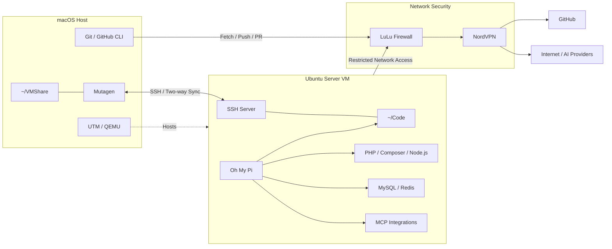

# Agentic Development Environment

A reproducible setup guide for an isolated AI-assisted development environment.

## Purpose

Run AI coding agents in an isolated environment while keeping source code review, Git operations, and access to sensitive resources under human control.

## Architecture

The environment consists of two systems:

- **Host:** Code editing and reviewing changes, managing Git repositories, and accessing GitHub.
- **Virtual machine:** Runs AI coding agents, development tools, project dependencies, and tests.

UTM provides virtualization, while Mutagen synchronizes selected folder(s) between the host and the VM over SSH.

## Security Model

The virtual machine is treated as an untrusted execution environment.

Core principles:

- AI agents do not receive the host's SSH keys or GitHub credentials.
- The VM's network access is restricted using host firewall rules.
- Production credentials and sensitive data must not be copied into the VM.
- Only projects explicitly placed in `~/VMShare` are synchronized into the VM.
- Project changes made by agents are synchronized to the host for review.
- Agent-generated changes require human review before being committed.
- Git commits, pushes, and pull requests are managed by the developer on the host.

> [!IMPORTANT]
> **Isolation is not absolute.** The VM shares the host's physical hardware, and Mutagen intentionally allows changes made inside the VM to propagate into `~/VMShare`.

## Requirements

> [!TIP]
> This guide reflects my own opinionated development environment, using a macOS host and an Ubuntu VM, but feel free to adapt it to your own needs and preferences.

- macOS (Apple Silicon)
- UTM with QEMU virtualization
- Ubuntu Server ARM64
- SSH access between host and VM
- Mutagen for bidirectional file synchronization
- LuLu for host-level network restrictions
- NordVPN for host-level VPN connectivity
- Oh My Pi as the AI coding agent

The instructions focus on a single-developer workflow and avoid unnecessary infrastructure or automation.
