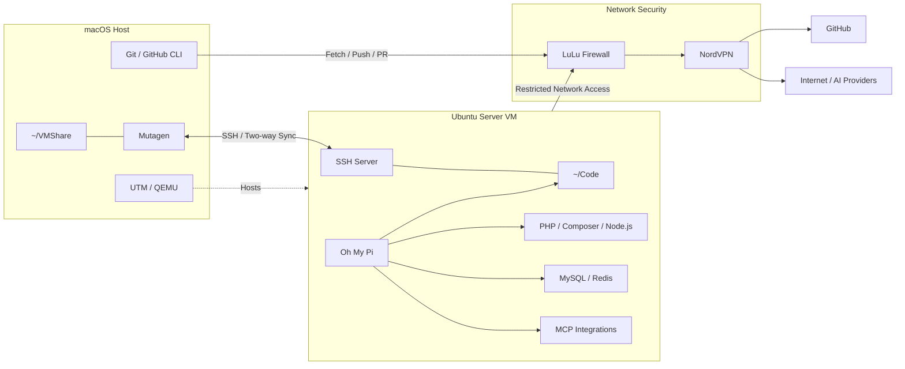

# Agentic Development Environment

A reproducible setup guide for an isolated AI-assisted development environment.

## Purpose

Run AI coding agents in an isolated environment while keeping source code review, Git operations, and access to sensitive resources under human control.


## Architecture

The environment consists of two systems:

- **Host:** Code editing and reviewing changes, managing Git repositories, and accessing GitHub.
- **Virtual machine:** Runs AI coding agents, development tools, project dependencies, and tests.



UTM provides virtualization, while Mutagen synchronizes selected folder(s) between the host and the VM over SSH.

## Security Model

The virtual machine is treated as an untrusted execution environment.

Core principles:

- AI agents do not receive the host's SSH keys or GitHub credentials.
- The VM's network access is restricted using host firewall rules.
- Production credentials and sensitive data must not be copied into the VM.
- Only projects explicitly placed in `~/VMShare` are synchronized into the VM.
- Project changes made by agents are synchronized to the host for review.
- Agent-generated changes require human review before being committed.
- Git commits, pushes, and pull requests are managed by the developer on the host.

> [!IMPORTANT]
> **Isolation is not absolute.** The VM shares the host's physical hardware, and Mutagen intentionally allows changes made inside the VM to propagate into `~/VMShare`.

## Requirements

> [!TIP]
> This guide reflects my own opinionated development environment, using a macOS host and an Ubuntu VM, but feel free to adapt it to your own needs and preferences.

- macOS (Apple Silicon)
- UTM with QEMU virtualization
- Ubuntu Server ARM64
- SSH access between host and VM
- Mutagen for bidirectional file synchronization
- LuLu for host-level network restrictions
- NordVPN for host-level VPN connectivity
- Oh My Pi as the AI coding agent

The instructions focus on a single-developer workflow and avoid unnecessary infrastructure or automation.

## macOS Host Setup

### 1. Install UTM

[UTM](https://mac.getutm.app/) provides the virtual machine environment used to run Ubuntu Server.

Install UTM using Homebrew:

```bash
brew install --cask utm
```

This setup uses **QEMU emulation** rather than Apple's native virtualization framework.

QEMU was selected to support the required virtual networking configuration, including SSH port forwarding and host-level network restrictions.

> [!NOTE]
> QEMU emulation introduces some performance overhead compared to native virtualization. For this workflow, the trade-off is acceptable because AI inference runs outside the VM, while the VM handles development tools, code execution, and tests.

### 2. Install Mutagen

[Mutagen](https://mutagen.io/) provides continuous, bidirectional file synchronization between the macOS host and the Ubuntu VM over SSH.

Unlike a mounted shared folder, Mutagen maintains independent copies of the project files on both systems. This allows development tools, Git, and file watchers to operate on the VM's native filesystem.

Install Mutagen using Homebrew:

```bash
brew install mutagen-io/mutagen/mutagen
```

Verify the installation:

```bash
mutagen version
```

> [!NOTE]
> Mutagen synchronization sessions will be configured after setting up the Ubuntu VM and SSH access. No synchronization

#### Why Mutagen instead of shared folders?

UTM's VirtFS/9P shared folders cause significant performance degradation for filesystem-intensive Git operations, particularly `git status`. Keeping project files on the VM's native filesystem and synchronizing them with Mutagen eliminated this bottleneck.

## Ubuntu Virtual Machine Setup

### 1. Download Ubuntu Server

Download the ARM64 version of [Ubuntu Server](https://ubuntu.com/download/server/arm).

This setup was tested with **Ubuntu Server 26.04 ARM64**.

### 2. Create the Virtual Machine

Open UTM and create a new virtual machine using the following settings:

| Setting | Value |
|---|---|
| Virtualization mode | Emulate |
| Operating system | Linux |
| Architecture | ARM64 (aarch64) |
| Memory | 4 GB |
| CPU cores | 4 |
| Storage | 40 GB |
| Boot image | Ubuntu Server ARM64 ISO |
| VM name | `UbuntuVM` |

Use QEMU rather than Apple's virtualization framework.

The VM does not require a graphical desktop environment. Ubuntu Server is sufficient for running AI coding agents and development tools.

### 3. Install Ubuntu Server

Start the VM and complete the Ubuntu Server installation.

Recommended installation choices:

- Minimal Ubuntu Server installation.
- Enable the OpenSSH server.
- Do not import SSH keys from GitHub during installation.
- Do not install optional server snaps unless needed.
- Use a dedicated, non-root Linux user.
- Use a dedicated password for the VM user account. Do not reuse your macOS host password, including the one used for `sudo`.

After installation, remove the installation ISO from the virtual drive and reboot.

## VM Networking and SSH Access

### 1. Configure VM Networking

Shut down the Ubuntu VM before changing its network settings.

In UTM, open the VM settings and configure:

| Setting | Value |
|---|---|
| Network mode | Emulated VLAN |
| Network adapter | Emulated network adapter |
| Port forwarding | TCP, host `127.0.0.1:2222` → guest port `22` |

The forwarded SSH port allows the macOS host to connect to the VM without exposing the SSH service on the host's external network interfaces.

Start the VM and verify that its SSH server is running:

```bash
sudo systemctl status ssh
```

### 2. Create a Dedicated SSH Key

On the macOS host, generate a dedicated SSH key for the VM:

```bash
ssh-keygen -t ed25519 -f ~/.ssh/id_ed25519_ubuntu_vm -C "ubuntu-vm"
```

Do not reuse your existing GitHub SSH key.

Copy the public key into the VM user's `~/.ssh/authorized_keys` file. From the macOS host:

```bash
ssh-copy-id -i ~/.ssh/id_ed25519_ubuntu_vm.pub -p 2222 <vm-user>@127.0.0.1
```

If `ssh-copy-id` is unavailable, add the contents of the `.pub` file to `~/.ssh/authorized_keys` manually.

### 3. Configure an SSH Alias

Add the following entry to the macOS host's `~/.ssh/config`:

```sshconfig
Host uvm
    HostName 127.0.0.1
    Port 2222
    User <vm-user>
    IdentityFile ~/.ssh/id_ed25519_ubuntu_vm
    IdentitiesOnly yes
    ForwardAgent no
```

Replace `<vm-user>` with the Ubuntu username created during installation.

Test the connection:

```bash
ssh uvm
```

Verify that the connection succeeds using the dedicated SSH key.

> [!IMPORTANT]
> Keep the private SSH key on the macOS host. Do not copy host SSH credentials, GitHub credentials, or other sensitive authentication material into the VM.
>
> SSH agent forwarding is explicitly disabled to prevent the VM from using the host's SSH agent.
