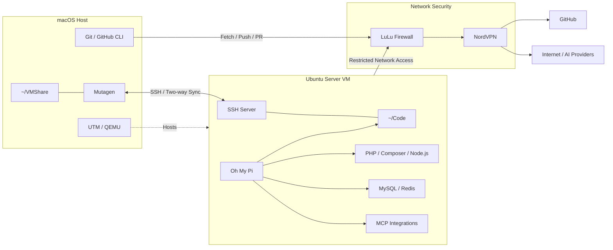

# Agentic Development Environment

A reproducible setup guide for an isolated AI-assisted development environment.

## Purpose

Run AI coding agents in an isolated environment while keeping source code review, Git operations, and access to sensitive resources under human control.

This setup is primarily designed for **Laravel/PHP development with MySQL and Node.js**, reflecting the technology stack used in my own projects. The underlying architecture can be adapted to other development environments.

> [!IMPORTANT]
> **This setup does not aim for absolute isolation.** Instead, it seeks a practical balance between security and usability for solo developers and small teams. The VM shares the host's physical hardware, and file synchronization intentionally allows changes made inside the VM to propagate to the host.

## Architecture

The environment consists of two systems, with an optional network security layer:

- **Host:** Code editing, reviewing changes, managing Git repositories, and accessing GitHub.
- **Virtual Machine:** Runs AI coding agents, development tools, project dependencies, and tests.
- **Network Security (optional):** Restricts the VM's network access and routes outbound traffic through a VPN connection.

## Security Model

The virtual machine is treated as an untrusted execution environment.

Core principles:

- AI agents **MUST NOT** have access to the host's SSH keys or GitHub credentials.
- Production credentials and sensitive data **MUST NOT** be copied into the VM.
- Only explicitly authorized projects **MAY** be synchronized into the VM.
- Changes made by AI agents **MUST** be reviewed by the developer before being committed.
- Git commits, pushes, and pull requests **MUST** be performed on the host.
- Using optional network security layer, the VM's network access **MUST** be restricted using host firewall rules.
- Changes made inside the VM **MAY** propagate to the host through file synchronization.

## Step-by-Step Setup Instructions

1. **Requirements**
   - 1.1. [System Requirements](docs/requirements.md)
2. **macOS Host Setup**
   - 2.1. [Install UTM](docs/install_utm.md)
   - 2.2. [Install Mutagen](docs/install_mutagen.md)
   - 2.3. [Install and Configure LuLu Firewall](docs/configure_lulu.md)
3. **Ubuntu Virtual Machine Setup**
   - 3.1. [Download Ubuntu Server](docs/download_ubuntu.md)
   - 3.2. [Create the Virtual Machine](docs/create_vm.md)
   - 3.3. [Install Ubuntu Server](docs/install_ubuntu.md)
4. **VM Networking and SSH Access**
   - 4.1. [Configure SSH Port Forwarding](docs/configure_ssh_forwarding.md)
   - 4.2. [Configure SSH Authentication](docs/configure_ssh.md)
   - 4.3. [Verify Network Isolation](docs/verify_network_isolation.md)
5. **Development Environment**
   - 5.1. [Install Development Tools](docs/install_dev_tools.md)
   - 5.2. [Configure File Synchronization](docs/configure_mutagen.md)
   - 5.3. [Install AI Coding Agent](docs/install_agent.md)
