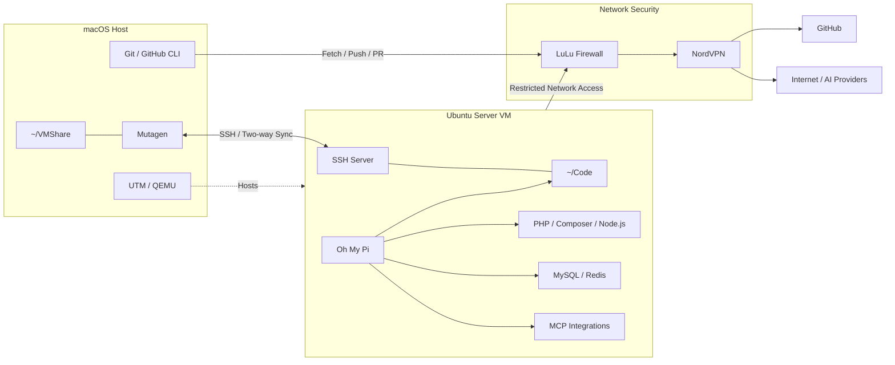

# Agentic Development Environment

A reproducible setup guide for an isolated AI-assisted development environment.

## Purpose

Run AI coding agents in an isolated environment while keeping source code review, Git operations, and access to sensitive resources under human control.

## Architecture

The environment consists of two systems:

- **Host:** Code editing and reviewing changes, managing Git repositories, and accessing GitHub.
- **Virtual machine:** Runs AI coding agents, development tools, project dependencies, and tests.

UTM provides virtualization, while Mutagen synchronizes the shraded `~/VMShare` folder between the host and the VM over SSH.

## Security Model

The virtual machine is treated as an untrusted execution environment.

Core principles:

- AI agents do not receive the host's SSH keys or GitHub credentials.
- The VM's network access is restricted using host firewall rules.
- Production credentials and sensitive data must not be copied into the VM.
- Only projects explicitly placed in `~/VMShare` are synchronized into the VM.
- Project changes made by agents are synchronized to the host for review.
- Agent-generated changes require human review before being committed.
- Git commits, pushes, and pull requests are managed by the developer on the host.

> [!IMPORTANT]
> **Isolation is not absolute.** The VM shares the host's physical hardware, and Mutagen intentionally allows changes made inside the VM to propagate into `~/VMShare`.

## Step-by-Step Setup Instructions

1. **Requirements**
   - 1.1. [System Requirements](docs/requirements.md)
2. **macOS Host Setup**
   - 2.1. [Install UTM](docs/install_utm.md)
   - 2.2. [Install Mutagen](docs/install_mutagen.md)
   - 2.3. [Configure LuLu Firewall](docs/configure_lulu.md)
3. **Ubuntu Virtual Machine Setup**
   - 3.1. [Download Ubuntu Server](docs/download_ubuntu.md)
   - 3.2. [Create the Virtual Machine](docs/create_vm.md)
   - 3.3. [Install Ubuntu Server](docs/install_ubuntu.md)
4. **VM Networking and SSH Access**
   - 4.1. [Configure SSH Access](docs/configure_ssh_forwarding.md)
