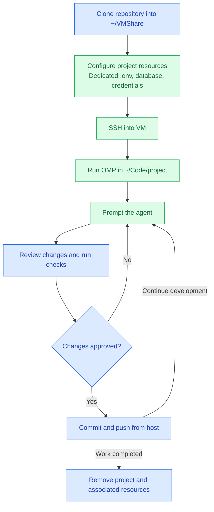

# Intended Workflow

The virtual machine should be treated as an **independent development workstation**, rather than an extension of the macOS host.

The same architecture could also be adapted to two physically separate computers. The VM provides a practical way to maintain this separation on a single machine.

## Workflow Overview

The following diagram illustrates the recommended development workflow, with **blue steps performed on the macOS host** and **green steps performed inside the Ubuntu VM**.



## Working Principles

### Minimal Project Exposure

- Only projects actively needed for development should be present in the host's `~/VMShare` directory and synchronized to the VM.
- Development databases should likewise be retained only as needed.
- Each project must be an **independent Git clone**, not a worktree or symbolic link to an existing host repository.
- Avoid symbolic links to directories outside the synchronized workspace.

### Independent Development Data

Each project should use its own development resources:

- A dedicated `.env` file.
- A separate local database and database user.
- Independently generated application keys and credentials.
- Synthetic or sanitized test data whenever possible.
- These resources must not reuse production secrets or depend on the host's existing development environment.
- Database users should have permissions limited to their own project databases.

### Restricted GitHub Access

GitHub authentication is intentionally not configured inside the VM.

The synchronized Git repositories retain their remote URLs and history, but the VM does not receive the host's GitHub SSH keys, authentication tokens, or GitHub CLI (`gh`) configuration. The agent can inspect local Git history and changes but cannot perform authenticated GitHub operations using the host's credentials.

This limits some agent capabilities, including fetching private repositories, accessing private issues, and creating pull requests. The restriction is intentional.

> [!IMPORTANT]
> This is not a complete network restriction. The VM still has outbound internet access, and publicly accessible GitHub resources may remain reachable.

## Development Workflow

### 1. Prepare a Project

On the macOS host, create an independent clone inside the synchronized directory:

```bash
cd ~/VMShare
git clone git@github.com:OWNER/REPOSITORY.git
```

- Configure the project with development-only environment variables, application keys, and dependencies.
- Create a dedicated database and database user inside the VM. Grant the user privileges only on that project's database.

### 2. Work Inside the VM

Connect to the VM using SSH, navigate to the synchronized project and start OMP:

```bash
ssh uvm
cd ~/Code/REPOSITORY
omp
```

Use the agent to plan, implement, and test changes through iterative prompts.

> [!WARNING]
> Dependency installation, build scripts, and test execution must also be treated as potentially untrusted operations. They can execute arbitrary code with the permissions of the VM user.

### 3. Review and Publish on the Host

- Review the changes using the host's IDE editor, Git tools, and automated checks.
- Perform Git commits, pushes, and pull request operations on the host, after reviewing the results.
- The agent must not receive the host's GitHub credentials or SSH agent access.

> [!WARNING]
> File synchronization does not provide a security boundary. Changes made by the agent can propagate to the host before they are reviewed. The synchronized directory must therefore remain separate from trusted working copies.

### 4. Remove the Project When Finished

Once the work is complete and all intended changes have been committed or otherwise preserved:

1. Remove the project's clone from `~/VMShare` on the macOS host.
2. Allow Mutagen to synchronize the deletion to the VM.
3. Remove the project's development database and MySQL user if they are no longer needed. They may be retained for future work, provided they contain no sensitive data and their permissions remain restricted to that project.

> [!WARNING]
> Mutagen synchronizes deletions in both directions. Removing a project from either side can delete its synchronized counterpart. Ensure that all required changes have been preserved before cleanup.

The VM should retain only the projects and resources needed for ongoing work.
